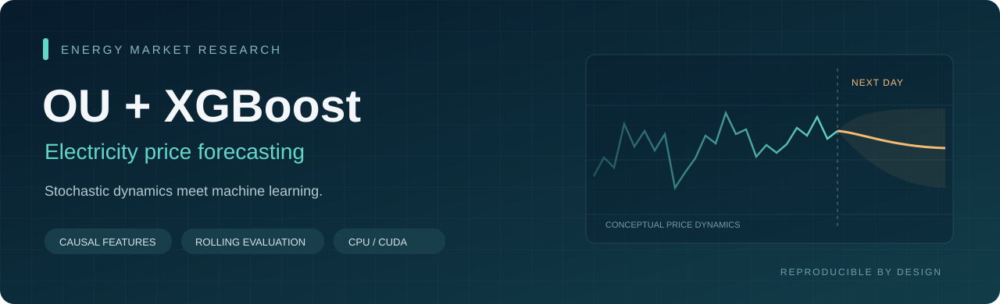
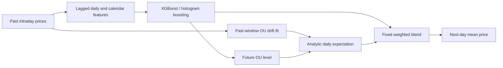
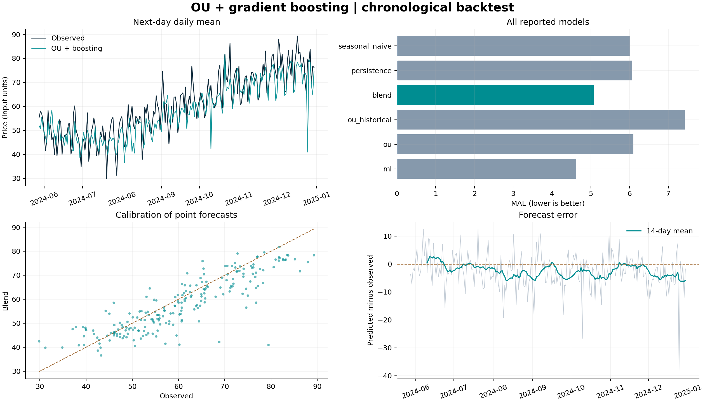

<p align="center"></p>

<p align="center">
  <a href="https://github.com/BehnamMohseniGharyehsafa/ou-xgboost-energy/actions/workflows/ci.yml"></a>
  
  <a href="LICENSE"></a>
  
</p>

# OU + XGBoost for electricity price forecasting

A research Python package that combines **Ornstein–Uhlenbeck mean reversion** with **gradient-boosted trees** to predict the next UTC day's average electricity price. It includes chronological backtests, an unseen next-day forecast command, CPU/CUDA selection, baseline comparisons, and reproducible experiment artifacts.

**Author:** Behnam Mohseni Gharyehsafa · **Status:** research implementation, v0.1.0

> **Forecast timing matters.** The information set contains all observations before the target UTC midnight. This is an end-of-day, next-day experiment. A market auction that closes earlier requires a different information cutoff and availability-aware features. No real market performance is claimed by the synthetic demonstration.

## What this repository provides

| Component | Implementation |
| :--- | :--- |
| Statistical dynamics | Windowed OU drift estimation with jump trimming and gap exclusion |
| Nonlinear forecast | XGBoost histogram trees; scikit-learn histogram boosting fallback |
| Hybrid forecast | Analytic OU expectation with the ML forecast as its future level, then a fixed blend |
| Evaluation | Expanding training window, scheduled refits, persistence and weekly seasonal baselines |
| Data handling | Explicit column selection, finite values, regular UTC grid, complete-day targets |
| Reproducibility | Seed, input SHA-256, dependency versions, features and actual device in `run.json` |
| Validation | Causality, analytic expectation, missing data, negative prices, CLI and backend tests |

## Quick start

Python 3.10 or later is required. From a terminal:

```bash
git clone https://github.com/BehnamMohseniGharyehsafa/ou-xgboost-energy.git
cd ou-xgboost-energy
python -m venv .venv
```

Activate the environment:

```bash
# Linux / macOS
source .venv/bin/activate
```

```powershell
# Windows PowerShell
.venv\Scripts\Activate.ps1
```

Install and run the reproducible synthetic example:

```bash
python -m pip install -e ".[xgb,plots]"
energy-forecast demo --days 365 --seed 42 --out data/synthetic_prices.csv
energy-forecast backtest --csv data/synthetic_prices.csv --device cpu --plots --out outputs/demo
energy-forecast forecast --csv data/synthetic_prices.csv --device cpu --out outputs/next-day
```

The same interface is available as `python -m energy_forecast`. For a minimal CPU installation, use `python -m pip install -e .` and `--backend hist`; omit `--plots` unless plotting support is installed.

## Bring your own price series

```csv
timestamp,price
2024-01-01T00:00:00Z,74.25
2024-01-01T01:00:00Z,-3.50
2024-01-01T02:00:00Z,0.00
```

The target is an equally weighted daily mean in the input price units, for example EUR/MWh. Observations must align to the declared cadence from UTC midnight. Missing observations make a day incomplete; they are never silently interpolated. Naive timestamp strings are interpreted as UTC, so convert local-market timestamps explicitly before loading.

```bash
energy-forecast backtest --csv data/raw/market.csv --timestamp-col delivery_time --price-col SMP --cadence-minutes 30 --ou-window-days 60 --blend 0.5 --plots --out outputs/market
```

Use at least **149 consecutive complete days** with default settings: 28 for feature warm-up, 120 eligible training days, and one test day. More history is preferable for studying annual seasonality. See [the data contract](docs/data.md) for interval labels, gaps, timezones and daylight saving time.

## How the hybrid works



The continuous-time model is

```math
dP_t = \kappa(\theta-P_t)\,dt + \sigma\,dW_t.
```

For a future level $\theta_d$, last observed price $P_0$, horizon $H=24$ hours, and time $\delta$ from the last sample to target midnight:

```math
\widehat P_{\mathrm{OU},d}=\theta_d+(P_0-\theta_d)e^{-\kappa\delta}\frac{1-e^{-\kappa H}}{\kappa H}.
```

The hybrid sets $\theta_d=\widehat y_{\mathrm{ML},d}$ and computes

```math
\widehat y_d=w\widehat y_{\mathrm{ML},d}+(1-w)\widehat P_{\mathrm{OU},d}.
```

The default is $w=0.5$. The conditioned OU component shares the ML forecast; it is **not an independent second learner**. A separate historical-level OU baseline is also reported. If a positive mean-reversion speed cannot be estimated, the blend falls back to ML and records the reason. See [methodology and derivation](docs/methodology.md).

## Evaluation and outputs

For each test day, training labels come only from earlier eligible days. The tree is refreshed every seven calendar days by default; features and OU estimates update daily. No random train/test split or future-dependent preprocessing is used.

| File | Contents |
| :--- | :--- |
| `predictions.csv` | Forecasts, actuals for backtests, OU diagnostics, training cutoff, backend/device |
| `metrics.csv` | Per-model sample count, MAE, RMSE and signed bias; backtests only |
| `run.json` | Input fingerprint, full configuration, software versions and fallback counts |
| `diagnostics.png` | Forecast path, MAE comparison, scatter and residual diagnostics with `--plots` |

`yhat_ml` identifies the actual tree forecast even when scikit-learn is used. `yhat_ou` uses the ML-conditioned level; `yhat_ou_historical` uses the fitted historical level. Baselines are `yhat_persistence` and `yhat_seasonal_naive`. This replaces the misleading always-XGBoost column name in the original script. The forecast command emits no `y_true` and no evaluation metrics.

**MAE and RMSE remain in input units.** Bias is prediction minus observation. MAPE is omitted because division by zero or near-zero electricity prices is unstable. Metrics report individual finite-pair counts; compare common dates if OU availability differs. Details: [evaluation protocol](docs/evaluation.md).

## Reproduced demonstration

The checked-in [example report](examples/demo/README.md) contains results generated from a seeded artificial series, together with the configuration and input fingerprint. It reports every baseline without assuming the hybrid wins; XGBoost alone has the lowest MAE in this example.



## CPU and GPU behavior

- `--backend auto --device auto`: use XGBoost if available; verify CUDA through a tiny fit and the trained booster configuration; otherwise use CPU.
- `--backend xgboost --device cpu`: require XGBoost and use CPU explicitly.
- `--backend xgboost --device cuda`: require verified CUDA; fail with an explanatory error if unavailable.
- `--backend hist`: use scikit-learn on CPU without requiring XGBoost.

If CUDA training fails after an automatic selection, the fit retries on CPU and logs the change. Explicit CUDA requests fail rather than changing the requested device. The run manifest and each prediction record the actual backend/device. GPU requirements depend on the installed XGBoost build; consult the [official GPU documentation](https://xgboost.readthedocs.io/en/stable/gpu/index.html). Small daily datasets may run faster on CPU.

## Python API

```python
from energy_forecast import ForecastConfig, backtest, forecast_next_day
from energy_forecast.data import load_prices
from energy_forecast.evaluation import score_predictions

prices = load_prices("data/raw/market.csv", timestamp_col="timestamp", price_col="price")
config = ForecastConfig(backend="xgboost", device="cpu", blend_weight=0.5)
experiment = backtest(prices, config)
print(score_predictions(experiment.predictions))
next_day = forecast_next_day(prices, config)
print(next_day.predictions[["yhat_ml", "yhat_ou", "yhat_blend"]])
```

## Project layout

```text
src/energy_forecast/     data, features, OU, boosting, evaluation, reporting and CLI
tests/                  scientific and software regression tests
docs/                   methodology, data contract, evaluation and migration notes
examples/demo/          generated synthetic results and diagnostics
.github/workflows/      automated tests, lint, packaging and CLI smoke checks
```

## Development

```bash
python -m pip install -e ".[dev,xgb,plots]"
python -m pytest --cov=energy_forecast --cov-report=term-missing
ruff check .
ruff format --check .
python -m build
```

See [CONTRIBUTING.md](CONTRIBUTING.md) for the causality requirements and [CHANGELOG.md](CHANGELOG.md) for changes from the supplied prototype.

## Scope and scientific limits

The package predicts a single daily point estimate. It does not estimate diffusion volatility, prediction intervals, intraday price curves, demand/weather effects, auction-clearing outcomes, or trading profitability. The OU fit is a trimmed Euler drift approximation on raw prices; seasonality, spikes and structural breaks can violate its assumptions. The analytic continuous average approximates the discrete daily target. Model and blend settings are fixed defaults, not validated optima. Tune only on earlier validation periods and retain an untouched final test period.

## References and citation

- Uhlenbeck, G. E. & Ornstein, L. S. (1930). *On the Theory of the Brownian Motion*. Physical Review, 36, 823. [DOI](https://doi.org/10.1103/PhysRev.36.823).
- Chen, T. & Guestrin, C. (2016). *XGBoost: A Scalable Tree Boosting System*. KDD. [Paper](https://arxiv.org/abs/1603.02754).
- [XGBoost parameters](https://xgboost.readthedocs.io/en/stable/parameter.html) and [scikit-learn time-series validation](https://scikit-learn.org/stable/modules/cross_validation.html#time-series-split).

These references explain underlying methods; they do not validate this particular hybrid. To cite the software, use [CITATION.cff](CITATION.cff). Code and bundled synthetic artifacts are distributed under the [MIT license](LICENSE); third-party market data retain their own terms.
